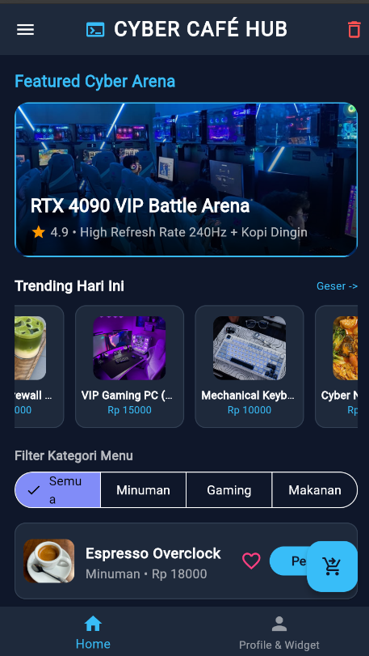
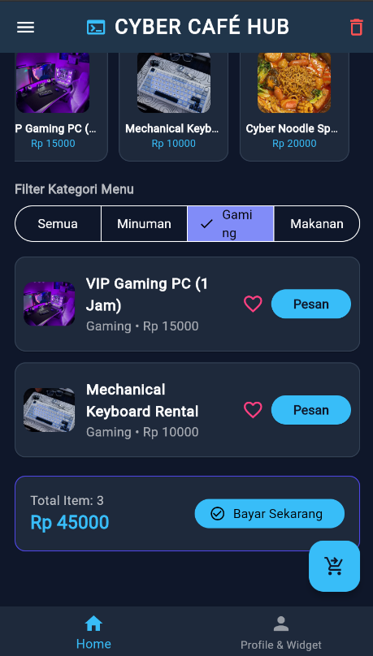
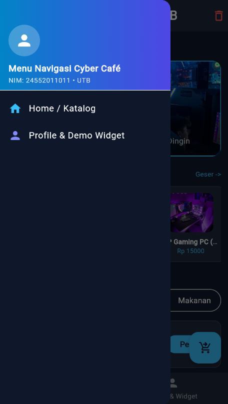
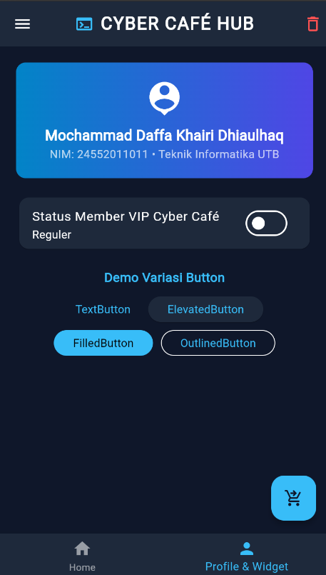
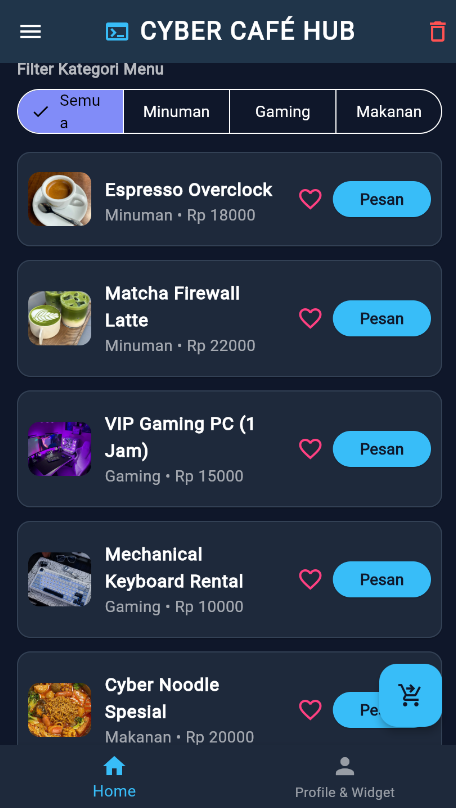

# Cyber Café & Gaming Hub - Flutter Themed App

Tugas Pemrograman Mobile 2: Membuat aplikasi Flutter bertema (*themed app*).

## Deskripsi Singkat
**Cyber Café Hub** adalah aplikasi pemesanan menu kafe dan paket *billing* warnet/gaming dengan tema antarmuka **Dark Tech / Cyberpunk**. Aplikasi ini menggunakan kustomisasi `ThemeData` gelap, komponen `ListView.builder`, serta *state management* dasar (`StatefulWidget`) untuk menghitung total pesanan secara *real-time*.

## Fitur Utama
- **Custom Dark Theme**: Palet warna *slate dark* dengan aksen *neon cyan* & *indigo*.
- **Katalog Menu & Layanan**: Daftar item lengkap dengan gambar aset lokal, ikon, kategori, dan harga.
- **Keranjang Interaktif**: Menghitung jumlah item dan total harga secara otomatis pada area *bottom sheet*, disertai notifikasi `SnackBar` dan *Floating Action Button*.
- **Sistem Navigasi Lengkap**: Menggunakan `Drawer` untuk menu samping dan `BottomNavigationBar` untuk perpindahan halaman (Home & Profile).
- **Filter Kategori Dinamis**: Menggunakan komponen `SegmentedButton` untuk menyortir tampilan menu berdasarkan kategori (Semua, Minuman, Gaming, Makanan).
- **Variasi Basic Widget**: Implementasi `SwitchListTile` interaktif serta demonstrasi penggunaan berbagai tombol bawaan Material Design (`TextButton`, `ElevatedButton`, `FilledButton`, `OutlinedButton`).

## Screenshot Hasil Aplikasi

  
  

  
  

  

