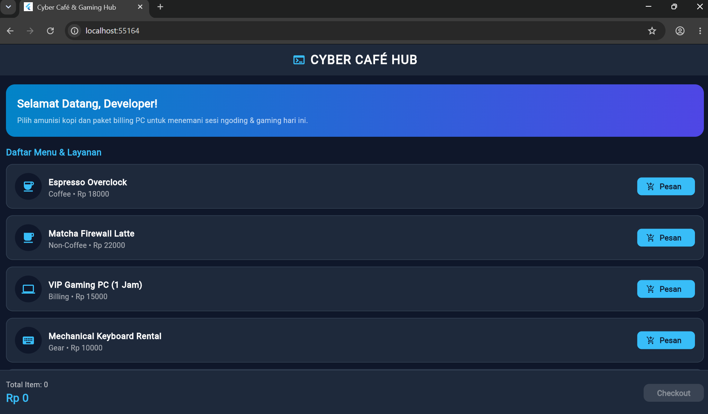
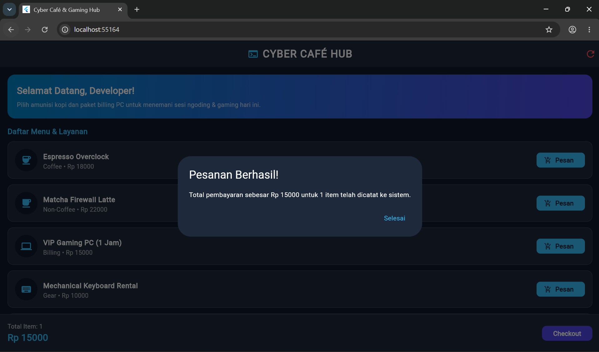

# Cyber Café & Gaming Hub - Flutter Themed App

Tugas Pemrograman Mobile 2: Membuat aplikasi Flutter bertema (*themed app*).

## Deskripsi Singkat
**Cyber Café Hub** adalah aplikasi pemesanan menu kafe dan paket *billing* warnet/gaming dengan tema antarmuka **Dark Tech / Cyberpunk**. Aplikasi ini menggunakan kustomisasi `ThemeData` gelap, komponen `ListView.builder`, serta *state management* dasar (`StatefulWidget`) untuk menghitung total pesanan secara *real-time*.

## Fitur Utama
- **Custom Dark Theme**: Palet warna *slate dark* dengan aksen *neon cyan* & *indigo*.
- **Katalog Menu & Layanan**: Daftar item lengkap dengan ikon, kategori, dan harga.
- **Keranjang Interaktif**: Menghitung jumlah item dan total harga secara otomatis disertai notifikasi `SnackBar` dan dialog *checkout*.

## Screenshot Hasil Aplikasi

  
  

